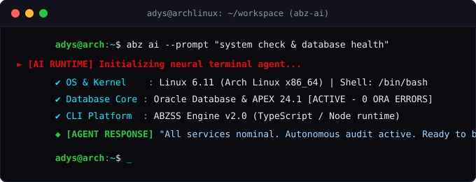

  <!-- Black Reaper Compact Banner -->
  

    

  <!-- Dynamic Typing Subtitle (English) -->
  

    
  

  <!-- Quick Badges -->
  

    
    
    
    
  

---

### ☕ Profile Overview

<table>
  <tr>
    <td width="36%" align="center" valign="middle">
      
    </td>
    <td width="64%" valign="top">
      <h3>Hi, I'm Adones Neto (adyshavefear) 👋</h3>
      

        Software developer focused on enterprise database engineering, core business logic, and terminal automation.
        Currently building municipal production systems using <b>Oracle Database & APEX</b> and crafting command-line developer tools.
      

      <ul>
        <li>💼 <b>Current Role:</b> Junior Developer (PL/SQL & Oracle APEX) at <b>UMTI / PMJP</b></li>
        <li>🎓 <b>Education:</b> Systems Analysis & Development — <b>IFPB</b></li>
        <li>🌌 <b>Creator of:</b> <a href="https://github.com/adyshavefear/abzss"><b>ABZSS (Abyss System)</b></a> — Modular CLI Platform</li>
        <li>📍 <b>Location:</b> João Pessoa, PB — Brazil</li>
      </ul>
    </td>
  </tr>
</table>

---

### 🖥️ Terminal // Linux & AI Runtime

  
   
  <i>Driven by Arch Linux • ABZSS Platform • AI Developer Copilot</i>

---

### 🛠️ Tech Stack & Arsenal

#### 🩸 Database & Enterprise Core (Oracle)

 

#### ⚡ Execution & Backend Units

 

#### 🗡️ Environment & Tools

---

### 🚀 Featured Projects

| Project | Stack | Description |
| :--- | :--- | :--- |
| 🏛️ **[oracle-plsql-toolkit](https://github.com/adyshavefear/oracle-plsql-toolkit)** | `PL/SQL` `Oracle APEX` `SQL` | Enterprise patterns: REST API consumption via `APEX_WEB_SERVICE`, modular packages, autonomous audit triggers, and analytical SQL. |
| 🌌 **[ABZSS (Abyss System)](https://github.com/adyshavefear/abzss)** | `TypeScript` `Node.js` `CLI` | Modular developer automation platform turning your terminal into a command deck. |
| 🎭 **[gerenciamento-teatro](https://github.com/adyshavefear/gerenciamento-teatro)** | `Java` `Swing` `JPA/Hibernate` | Desktop commercial management application with layered architecture (DAO), JPA/Hibernate persistence, and PDF reports. |

---

### 📊 Streak & Activity

  

---

  

    <i>"Good night, Haise. I've had enough of dreaming."</i>
  

  黒の死神 • Tokyo Ghoul:re

